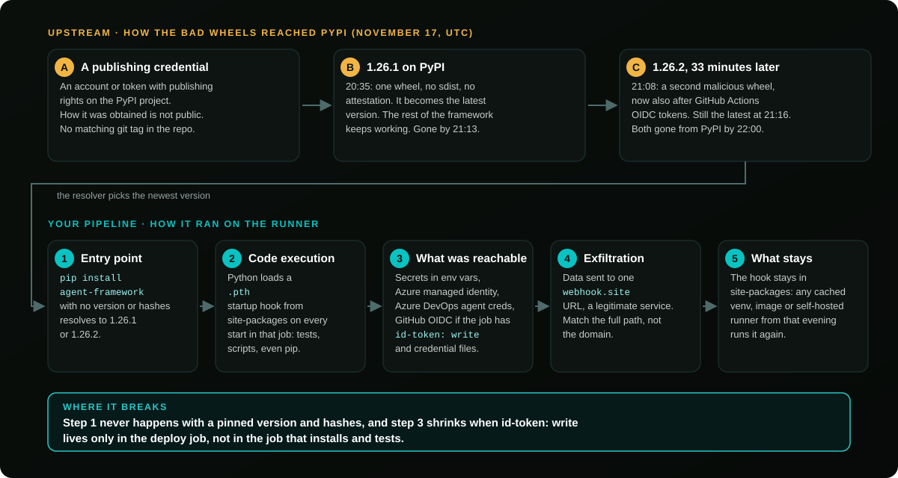

On November 17, 2026, `agent-framework` `1.26.1` and then `1.26.2` went up on PyPI. This is the meta package of the Microsoft Agent Framework. Both releases carry a credential stealer that runs on every Python start, and neither matches a release tag in the project's repository. Both were gone from PyPI by 22:00 UTC.

`agent-framework` had 41,366 PyPI downloads in the week before. Per [Endor Labs](https://www.endorlabs.com/learn/agent-framework-compromised-software-supply-chain-attack), the payload "is written for CI runners and Azure workloads". If one of your pipelines ran `pip install agent-framework` with no version that evening, the pipeline was the door.

## What happened

**The releases**

- November 17, 20:35:20 UTC: `1.26.1` is uploaded to [PyPI](https://pypi.org/project/agent-framework/) as a single wheel, with no sdist and no attestation, and becomes the latest version ([Endor Labs](https://www.endorlabs.com/learn/agent-framework-compromised-software-supply-chain-attack)).
- 20:54 UTC: an outside researcher reports it in issue #10411 on the project's GitHub repository.
- 21:06:16 UTC: PyPI admins quarantine `1.26.1` ([StepSecurity](https://www.stepsecurity.io/blog/microsoft-agent-framework-pypi-package-compromised), [PyPI](https://pypi.org/project/agent-framework/1.26.1/)).
- 21:08:39 UTC: `1.26.2` goes up anyway, after the quarantine of `1.26.1` ([Chainguard](https://www.chainguard.dev/unchained/microsoft-agent-framework-compromised-on-pypi-november-2026)), again one wheel, no sdist, no attestation. PyPI admins quarantine it at 21:16:44 UTC ([StepSecurity](https://www.stepsecurity.io/blog/microsoft-agent-framework-pypi-package-compromised)). This one also goes after GitHub Actions OIDC tokens ([Endor Labs](https://www.endorlabs.com/learn/agent-framework-compromised-software-supply-chain-attack)).
- By 22:00 UTC, both versions are gone, both are marked as quarantined by PyPI admins ([PyPI](https://pypi.org/project/agent-framework/1.26.2/)), and [PyPI](https://pypi.org/simple/agent-framework/) lists `1.26.0` (November 12) as the newest release.

**What it does, at defender level**

- Both wheels pin the real `agent-framework-core[all]==1.26.0`, so your application keeps working and nothing looks broken.
- A `.pth` file in `site-packages` runs the payload each time Python starts in that environment.
- It reads environment variables with secret-looking names, including those of other processes on the same machine ([Aikido Security](https://www.aikido.dev/blog/two-malicious-agent-framework-releases-hit-pypi-in-33-minutes)), Azure managed identity tokens, Azure DevOps OIDC tokens and agent credential files, GitHub Actions OIDC tokens where the job has `id-token: write`, and files such as `.npmrc`, `.netrc`, `.git-credentials` and `.docker/config.json`. It sends them to one `webhook.site` URL ([Endor Labs](https://www.endorlabs.com/learn/agent-framework-compromised-software-supply-chain-attack)). It also reads Azure CLI config under `~/.azure/`, `pip.conf` and Hugging Face tokens ([Wiz](https://www.wiz.io/blog/malicious-version-of-microsofts-agent-framework-published-to-pypi)).

**How it was published**

- On November 17, the project's GitHub repository had a `python-1.26.0` tag and no `python-1.26.1` or `python-1.26.2` tag, and its release workflow did not publish to PyPI: per a comment in the workflow, Azure DevOps owns the build and publication. The repository is no longer public since November 18 (it returns a 404).
- Each release was a single wheel, while Microsoft's pipeline normally publishes a wheel and an sdist ([Aikido Security](https://www.aikido.dev/blog/two-malicious-agent-framework-releases-hit-pypi-in-33-minutes)), with no published provenance attestation ([StepSecurity](https://www.stepsecurity.io/blog/microsoft-agent-framework-pypi-package-compromised)).
- Per [StepSecurity](https://www.stepsecurity.io/blog/microsoft-agent-framework-pypi-package-compromised), a maintainer account, `vibiret`, was created and added to the project on November 17. StepSecurity also says the evidence does not establish which account or credential uploaded the two wheels. Its [PyPI profile](https://pypi.org/user/vibiret/) shows it joined on November 17, 2026 and maintains `agent-framework` and five other packages of the framework: `agent-framework-openai`, `agent-framework-redis`, `agent-framework-postgres`, `agent-framework-purview` and `agent-framework-tools`. None of those five has had a release since November 12. On November 18 at about 18:00 UTC, the same profile also lists `vibiret` as a maintainer of [`semantic-kernel`](https://pypi.org/project/semantic-kernel/), `autogen-core`, `autogen-ext`, `autogen-agentchat` and `pyautogen`. None of them has had a release since November 12: the latest `semantic-kernel` is `1.47.0`, from November 5. How the account got maintainer rights is not public yet.
- Per [Wiz](https://www.wiz.io/blog/malicious-version-of-microsofts-agent-framework-published-to-pypi) (updated November 18), the attacker appears to have compromised a client certificate and private key for Microsoft ESRP (Engineering System Release Pipeline), the internal service Microsoft uses to sign and publish this package. A first publish attempt from AWS was rejected by ESRP's IP filtering; a second one, from Microsoft-owned IP space, succeeded. How those credentials were obtained is not known yet.
- Per [Chainguard](https://www.chainguard.dev/unchained/microsoft-agent-framework-compromised-on-pypi-november-2026), the Microsoft-associated PyPI publisher has been quarantined, and researchers believe the attacker may still hold publishing access.
- At 22:08 UTC, a member of the Microsoft GitHub organization confirmed on the issue that both versions "have been pulled from the package feed" and that the team is investigating.

## The Plumber take

**The runner is the crown jewel.** The payload goes after Azure DevOps agent credentials, GitHub Actions OIDC tokens and the Azure managed identity of the machine. In short: the things a CI job holds for a few minutes that let it log in to your cloud.

**An OIDC token is a login.** Teams moved to OIDC to get rid of long-lived cloud keys, and that was right. But a job with `id-token: write` can mint a cloud login for anyone who runs code in it, including a test dependency. Give `id-token: write` to the one job that deploys, and run your tests and installs somewhere else.

**Pulling the bad version is not the fix.** PyPI quarantined `1.26.1`, and `1.26.2` went up anyway at 21:08 UTC. As long as the publishing credential works, the next upload can come at any minute. On your side, the only thing that holds is a version and a hash you chose.

In our [State of CI/CD Security 2026](/blog/state-of-cicd-security-2026) research, 55% of projects still have unpinned or mutable dependencies. That is the population that picks up a release like this one on its own.

If your CI cannot say which bytes it ran on November 17 between 20:35 and 22:00 UTC, you cannot answer the question your CEO will ask tomorrow: "were we exposed?". That answer should take an hour, not a week.

## Are you exposed?

### The 60-second check

<Aside variant="caution" title="Three quick checks">

**1. Pinned to a bad version today** (repo files, GitHub or GitLab):

~~~bash
P='(^|[^a-z0-9_.-])agent[-_]framework(\[[^]]*\])? *===? *1\.26\.[12]([^0-9a-z.]|$)|(^|[^a-z0-9_.-])agent[-_]framework-1\.26\.[12]([- .]|$)|d27fa34414e6201d5e03|3d20a8bc91351a9a16b6'
grep -rnE "$P" .
~~~

It covers requirements files, `pyproject.toml`, `uv.lock`, `poetry.lock` and `Pipfile.lock`.

**2. Installed during the window** (November 17, 20:35 to 22:00 UTC): search the logs of every CI job that installed Python packages in that window for the same pattern (commands below). This is the check that matters for unpinned installs.

**3. Your pipeline config**: `plumber analyze github.com/OWNER/REPO` or [your score](https://score.getplumber.io/github.com/OWNER/REPO). `ISSUE-803` flags any workflow or job on `permissions: write-all`, which hands an OIDC token to every step, a poisoned package included. Then check by hand which jobs both install packages and hold `id-token: write`.

</Aside>

### Detailed check

Two questions, in this order:

- **Exposed today**: do your files point at `1.26.1` or `1.26.2`?
- **Exposed during the window**: did a job install one of them between November 17, 20:35 UTC and the removal (by 22:00 UTC)?

A hit in today's files does not prove exposure during the window. A clean repo today proves nothing about that evening.

#### Your files, GitHub or GitLab

~~~bash
P='(^|[^a-z0-9_.-])agent[-_]framework(\[[^]]*\])? *===? *1\.26\.[12]([^0-9a-z.]|$)|(^|[^a-z0-9_.-])agent[-_]framework-1\.26\.[12]([- .]|$)|d27fa34414e6201d5e03|3d20a8bc91351a9a16b6'
grep -rnE "$P" .
grep -rnE '^[^#]*pip3? install[^#]*agent[-_]framework([^-_a-z]|$)' .github/workflows .gitlab-ci.yml azure-pipelines.yml Dockerfile* 2>/dev/null
grep -rnE --include='*.txt' --include='*.in' --include='*.toml' '(^ *|")agent[-_]framework(\[[^]]*\])? *($|[<>~!;#"])' .
~~~

- The first command finds the bad versions, or their wheel hashes, in any lockfile format.
- The second lists every install line that names `agent-framework`.
- The third lists every requirement on `agent-framework` without `==`.

Any line without an exact version and hashes could have pulled a bad version during the window.

#### GitHub Actions

List that evening's runs and search their logs:

~~~bash
gh run list --created '>=2026-11-17' --limit 200 --json databaseId,workflowName,createdAt
gh run view <RUN_ID> --log | grep -E "$P"
~~~

- A hit in a log is a yes, even if your files are clean today. `pip` logs it as `agent-framework-1.26.1`, `uv` as `agent-framework==1.26.1`; the pattern covers both.
- If that job had `id-token: write`, review the sign-ins of every cloud role it can assume, from the install time on.
- Delete the Actions caches built that evening: `gh cache list`, then `gh cache delete <id>`. A cached virtualenv keeps the startup hook.

#### GitLab CI and Azure Pipelines

- Open the job logs of the pipelines that ran in the window and search for `agent-framework-1.26.1`, `agent-framework-1.26.2` and `agent_framework-1.26.`. A hit is a yes.
- Clear the runner caches built that evening ("Clear runner caches" on the GitLab pipelines page).
- On Azure DevOps, treat the service connections, agent credentials and personal access tokens used by a hit job as exposed.
- Purge both versions from any internal mirror or proxy (`Artifactory`, `Nexus`, `devpi`) and block them there.

#### Machines, runners and images

Self-hosted runners, dev machines, servers, containers. If a machine may have installed a bad version, cut it off the network first, then check it with shell tools only. Do not run `pip` or `python` on it, not even `pip show` or `pip uninstall`: the payload runs on every Python start ([StepSecurity](https://www.stepsecurity.io/blog/microsoft-agent-framework-pypi-package-compromised)).

~~~bash
find / -name agent_framework_meta.pth -o -name af_runtime_diag.pth -o -name af_runtime_diag.py -o -name 'af_runtime_diag.*.pyc' -o -path '*/agent_framework_meta/_telemetry.py' -o -path '*/agent_framework_meta/__pycache__/_telemetry.*.pyc' -o -name 'agent_framework-1.26.[12].dist-info' 2>/dev/null
ps -eo pid,ppid,lstart,args | grep -iE '[p]ython'
grep -E 'd381fd80-ec62-42ad-8f5c-d1b15103c9bb|runtime-diagnostics/1' <your proxy or egress logs>
find / -name '*.pth' -path '*-packages/*' -exec grep -HnE '^import[[:blank:]]' {} + 2>/dev/null
~~~

- A file hit means that environment ran the payload. The first command also finds the cached bytecode of the payload files.
- Removing the package or the hook does not stop a collector process the payload already started, and that process can outlive the job ([StepSecurity](https://www.stepsecurity.io/blog/microsoft-agent-framework-pypi-package-compromised)). The `ps` line lists running Python processes with their start time: save that list and your logs, stop any Python process started after the install that you cannot explain, then rebuild the environment from a clean image rather than cleaning it in place.
- The last command lists every `.pth` line that runs code at each Python start. Some are normal (`distutils-precedence.pth` from setuptools, virtualenv or coverage hooks). Review any line you do not recognize ([Chainguard](https://www.chainguard.dev/unchained/microsoft-agent-framework-compromised-on-pypi-november-2026)).
- On cloud machines and self-hosted runners, look in your network or flow logs for calls to `169.254.169.254` (instance metadata) from processes that should not need it ([Chainguard](https://www.chainguard.dev/unchained/microsoft-agent-framework-compromised-on-pypi-november-2026)).
- A log hit means data left. `webhook.site` is a legitimate service: match the full path above, not the domain. [Wiz](https://www.wiz.io/blog/malicious-version-of-microsofts-agent-framework-published-to-pypi) reads a `200` response as data accepted and a `410` or `429` as likely rejected. Wiz also says the attacker's `webhook.site` token was on the free tier and a maximum of 50 requests were captured, and that those requests can still contain working cloud, CI and registry credentials. A low count does not tell you whether yours was one of them. Rotate in every case.
- Then rotate, from a clean machine, everything that environment could reach: managed identities, service principals, Azure CLI sessions, Azure DevOps agents, service connections and tokens, GitHub federated credentials, PyPI, npm, NuGet, Docker and Hugging Face tokens, git credentials, cloud and registry tokens, model provider keys. On a self-hosted runner or a shared machine, that includes the secrets of the other jobs and processes that ran on it: the payload also reads other processes' environments. Review audit logs from the install time on. Stolen managed identity and OIDC-exchanged tokens can stay valid for up to 24 hours (Wiz), so review sign-ins for at least the full day after the install.
- On a self-hosted runner, treat the runner's own credential files as read too, including registration files under `_work/_temp`, and re-register the runner. In Entra ID, remove any federated identity credential (`AzureADTokenExchange`) you do not expect, and check sign-in logs from November 17 on. Deleting a trust does not necessarily revoke tokens already issued ([StepSecurity](https://www.stepsecurity.io/blog/microsoft-agent-framework-pypi-package-compromised)).

## The fix that would have stopped it

GitHub Actions, before:

~~~yaml
permissions: write-all
jobs:
  test-and-deploy:
    runs-on: ubuntu-latest
    steps:
      - uses: actions/checkout@v4
      - run: pip install agent-framework pytest
      - run: pytest
      - uses: azure/login@v2
        with:
          client-id: ${{ vars.AZURE_CLIENT_ID }}
          tenant-id: ${{ vars.AZURE_TENANT_ID }}
          subscription-id: ${{ vars.AZURE_SUBSCRIPTION_ID }}
~~~

After:

~~~yaml
permissions:
  contents: read
jobs:
  test:
    runs-on: ubuntu-latest
    steps:
      - uses: actions/checkout@v4
      - run: pip install --require-hashes -r requirements.txt  # agent-framework==1.26.0 with --hash lines
      - run: pytest
  deploy:
    needs: test
    runs-on: ubuntu-latest
    environment: production
    permissions:
      contents: read
      id-token: write
    steps:
      - uses: azure/login@v2
        with:
          client-id: ${{ vars.AZURE_CLIENT_ID }}
          tenant-id: ${{ vars.AZURE_TENANT_ID }}
          subscription-id: ${{ vars.AZURE_SUBSCRIPTION_ID }}
~~~

Generate the hashed file with `pip-compile --generate-hashes`, or use `uv sync --locked` with a committed `uv.lock`. Then a new upload on PyPI changes nothing in your pipeline until a pull request bumps it. And the job that runs third-party code no longer holds the cloud login.

GitLab CI, same idea:

~~~yaml
test:
  image: python:3.12.7
  script:
    - pip install --require-hashes -r requirements.txt

deploy:
  needs: [test]
  id_tokens:
    AZURE_ID_TOKEN:
      aud: api://AzureADTokenExchange
  script:
    - ./deploy.sh
~~~

## Key takeaways

- `agent-framework` `1.26.1` and `1.26.2` on PyPI carried a credential stealer. Both are quarantined on PyPI. `1.26.0` is the version to pin. Do not move to a newer release until Microsoft confirms it is clean: the attacker may still hold publishing access.
- `vibiret`, the maintainer account added to the project on November 17, is also a maintainer of `agent-framework-openai`, `agent-framework-redis`, `agent-framework-postgres`, `agent-framework-purview`, `agent-framework-tools`, `semantic-kernel`, `autogen-core`, `autogen-ext`, `autogen-agentchat` and `pyautogen`. None has had a bad release, but pin them to exact versions with hashes too, and treat any release of them after November 12 with suspicion until Microsoft confirms it.
- A pipeline that ran an unpinned `pip install agent-framework` on November 17 between 20:35 and 22:00 UTC should treat that job's secrets and cloud logins as stolen, and on a self-hosted runner, those of everything else that ran on that machine.
- Check your CI logs for that evening, not only your repo. A clean lockfile today proves nothing about yesterday.
- Pin Python dependencies with exact versions and hashes. A second malicious version followed the first 33 minutes later.
- Keep `id-token: write` in the deploy job only. A test job that installs packages should not be able to mint a cloud login.
- Block `1.26.1` and `1.26.2` in your package proxy, and delete caches and images built in the window.
- Cut a machine you suspect off the network and do not run `pip` or `python` on it. Check for the `.pth` files from the shell, and rebuild it: deleting the files does not stop a collector that is already running.

## Next steps

- Install the Plumber app to analyze and fix your pipelines: [github.com/apps/plumber-agent](https://github.com/apps/plumber-agent)
- Scan your pipelines with the open source CLI: [/docs/cli/github](/docs/cli/github)
- Star [getplumber/plumber](https://github.com/getplumber/plumber)
- Sources: [Endor Labs](https://www.endorlabs.com/learn/agent-framework-compromised-software-supply-chain-attack), [Aikido Security](https://www.aikido.dev/blog/two-malicious-agent-framework-releases-hit-pypi-in-33-minutes), [OX Security](https://www.ox.security/blog/breaking-hijacked-releases-of-microsofts-official-agent-framework-steals-azure-and-ci-credentials/), [Wiz](https://www.wiz.io/blog/malicious-version-of-microsofts-agent-framework-published-to-pypi), [Chainguard](https://www.chainguard.dev/unchained/microsoft-agent-framework-compromised-on-pypi-november-2026), [Socket](https://socket.dev/blog/agent-framework-pypi-package-compromised-with-credential-stealer), [StepSecurity](https://www.stepsecurity.io/blog/microsoft-agent-framework-pypi-package-compromised), [PyPI project page](https://pypi.org/project/agent-framework/), [PyPI simple index](https://pypi.org/simple/agent-framework/), [PyPI profile of vibiret](https://pypi.org/user/vibiret/), [semantic-kernel on PyPI](https://pypi.org/project/semantic-kernel/), [pypistats](https://pypistats.org/packages/agent-framework). The project's GitHub issue #10411, tags and release workflow were read on November 17; the repository is no longer public.
