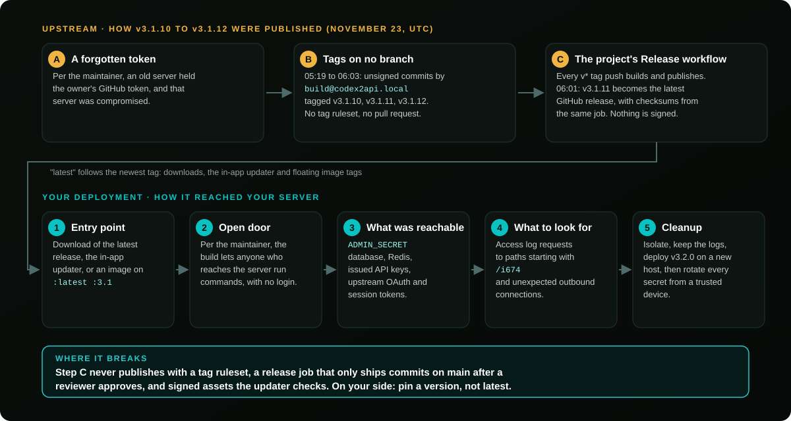

On November 23, 2026, between 05:19 and 06:03 UTC, three releases of `codex2api` went out with a backdoor: `v3.1.10`, `v3.1.11` and `v3.1.12`. The maintainer confirmed it the same morning and shipped `v3.2.0` as an emergency security update at 10:50 UTC.

`codex2api` is a self-hosted API proxy with 2,386 stars on GitHub. Nobody broke its build system. Someone held the owner's GitHub token, pushed three tags, and the project's own release workflow did the rest: the pipeline was the door.

## What happened

**The release**

- From 05:19 UTC, unsigned commits authored as `build <build@codex2api.local>` were tagged `v3.1.10`, `v3.1.11` and `v3.1.12`. None of them is on a branch ([issue #916](https://github.com/james-6-23/codex2api/issues/916)).
- The tags were pushed from the owner's account, and each push started the project's `Release` workflow. `v3.1.11` was published at 06:01:54 UTC by `github-actions[bot]` and became the latest GitHub release, with five platform archives and a `SHA256SUMS.txt` ([GitHub API, releases](https://api.github.com/repos/james-6-23/codex2api/releases)).
- Per the maintainer's [v3.2.0 release notes](https://github.com/james-6-23/codex2api/releases/tag/v3.2.0), the three versions contain a backdoor that lets unauthenticated visitors run commands on the server.

**The cleanup**

- The same account ran cleanup jobs that deleted `v3.1.10` and `v3.1.12` within minutes. Per the issue, one of them pointed the image tags `latest`, `3.1` and `3.1.10` on GitHub Container Registry back to the `3.1.9` image.
- `v3.1.11` stayed the latest release until at least 06:47 UTC. By about 09:00 UTC it was gone and `v3.1.9` was the latest again (GitHub API, read at both times).
- At 09:07 UTC the owner wrote that a GitHub token left on a server they had used long ago was the cause, and that this server had been compromised ([comment](https://github.com/james-6-23/codex2api/issues/916)).
- `v3.2.0` (10:50:36 UTC) is built from `main`. Its notes say the seven commits named in the report are outside its history.
- As of 11:00 UTC, neither the issue nor the release notes say whether the token was revoked. Watch [issue #916](https://github.com/james-6-23/codex2api/issues/916) before you trust the next release.

**How it was published**

The release came out of the project's own pipeline, exactly as designed.

- `release.yml` runs on every pushed tag that matches `v*`, with `contents: write`, and publishes what it builds. It has no approval step and no check that the tagged commit is on `main`.
- `docker-image.yml` runs on the same tags with `packages: write` and also moves the `latest` image tag.
- Checksums are written by the same job that builds the archives, and nothing is signed. A checksum made by the attacker's build matches the attacker's build.
- The repository had no rulesets and `main` was not protected when we read it on November 23. A branch rule would not have helped anyway: the tags pointed at commits outside every branch.

## The Plumber take

**A tag is a name, not a promise.** On this project, pushing a `v*` tag was the entire release process. Every server that follows "latest" (a download script, the in-app updater, a `:latest` image) took whatever that tag pointed at.

**Pipelines are production code.** A release workflow is a publishing key. Here it answered to one credential, and that credential sat on a machine its owner had stopped thinking about. Expiring, fine-grained tokens and a list of where your tokens live are boring work. This is what skipping them costs.

**A branch rule is not a release rule.** In our [State of CI/CD Security 2026](/blog/state-of-cicd-security-2026) research, 49% of projects leave their default branch unprotected. Protecting `main` matters, but this attack never touched `main`. Tags need their own rule, and the release job needs its own gate.

**Checksums are not signatures.** A `SHA256SUMS.txt` written by the release job proves the download was not corrupted. It does not prove who built it. An updater that checks a signature made with a key the CI never holds would have refused these builds.

If you self-host `codex2api`, the question today is simple: "which version did our server run this morning?". That answer should take an hour, not a week.

## Are you exposed?

### The 60-second check

<Aside variant="caution" title="Three quick checks">

**1. Pinned to a bad version today** (repo files, deploy scripts, compose files, manifests):

~~~bash
P='codex2api[:_ -]v?3\.1\.1[0-2]([^0-9]|$)|8994545a72e308441e57|62bfb74d2c46f7fa39e5|cabec2002aa60854904d|8d883ccbcd5b5b37cb37|ed12ff2b2e978c917110'
grep -rnE "$P" .
~~~

It finds image references such as `codex2api:3.1.11`, release archive names, and the SHA-256 of the five `v3.1.11` archives.

**2. Ran during the window** (November 23 from 05:19 UTC): on every server that runs `codex2api`, search the access logs for requests to paths starting with `/i674`, the pattern the issue reporter asks to look for (command below). Check the running version too: anything on `:latest`, `:3.1` or the in-app updater that day needs a look.

**3. Your own release pipeline**: `plumber analyze github.com/OWNER/REPO` or [your score](https://score.getplumber.io/github.com/OWNER/REPO). `ISSUE-510` flags a repository whose tags are not covered by a ruleset, and rates it critical when a workflow runs on a tag push, the exact setup used here.

</Aside>

### Detailed check

Two questions, in this order:

- **Exposed today**: does a server still run `v3.1.10`, `v3.1.11` or `v3.1.12`, or do your files point at them?
- **Exposed during the window**: did a server download, update to, or restart on one of them from November 23, 05:19 UTC until the release was gone (between 06:47 and about 09:00 UTC by our reads)?

A server on `v3.2.0` now proves nothing about this morning. Updating does not undo what ran before.

#### Your files, GitHub or GitLab

~~~bash
grep -rnE "$P" .
grep -rnE 'codex2api[^ ]*:(latest|3\.1)([^.0-9a-z_-]|$)' .
~~~

- The first command finds the bad versions or their archive hashes.
- The second lists every reference to the floating `latest` and `3.1` image tags. Those followed the newest release and need the server check below.
- A Helm values file that puts the repository and the tag on separate lines will not match: read those by eye.

#### Servers, containers and images

On each host that runs `codex2api`:

~~~bash
grep -E '("[A-Z]+ |"uri": ?")/i674' /var/log/nginx/access.log*
zgrep -E '("[A-Z]+ |"uri": ?")/i674' /var/log/nginx/access.log*.gz
docker ps --format '{{.Image}} {{.RunningFor}}' | grep codex2api
docker image ls --digests | grep codex2api
~~~

- The log pattern covers nginx and Apache combined logs and Caddy JSON logs. Point it at your proxy's log path.
- A container or image created on November 23 between 05:19 and about 09:00 UTC is suspect. The maintainer asks anyone who used the online updater or the `latest` image during the incident to check which version, or which image digest, actually ran.

If any of these says yes, follow the maintainer's order. It matters:

1. Treat the instance as compromised. Isolate it and keep its logs.
2. Deploy `v3.2.0` in a new, trusted environment. Do not reuse the old host.
3. From a trusted device, rotate everything the old instance could read: `ADMIN_SECRET`, the database and Redis passwords, every API key it issued, and the upstream accounts' OAuth tokens, session tokens and API keys.
4. Check for unusual access and outbound connections from the old host and anything it could reach.

Rotating from the compromised host, or before you move off it, hands the new secrets to the attacker.

#### GitHub Actions

If you publish releases from tags, look at your own repository the way this attack did:

~~~bash
gh api repos/OWNER/REPO/rulesets
gh run list --event push --limit 50 --json headBranch,workflowName,createdAt,actor
~~~

- An empty ruleset list means anyone with push access can create or move a release tag.
- A tag-triggered run you do not recognise, or one on a tag whose commit is on no branch, is worth a closer look.

#### GitLab CI

- Settings > Repository > Protected tags: protect `v*` (or `*`) and allow only Maintainers to create them.
- Settings > CI/CD > Protected environments: require an approval for the environment your release job deploys to.

## The fix that would have stopped it

GitHub Actions, before (simplified from the project's `release.yml`):

~~~yaml
on:
  push:
    tags:
      - 'v*'
permissions:
  contents: write
jobs:
  release:
    runs-on: ubuntu-latest
    steps:
      - uses: actions/checkout@v5
      # build the archives, write SHA256SUMS.txt
      - uses: softprops/action-gh-release@v2
~~~

After:

~~~yaml
on:
  push:
    tags:
      - 'v*'
permissions:
  contents: read
jobs:
  release:
    runs-on: ubuntu-latest
    environment: release          # required reviewers
    permissions:
      contents: write             # create the release
      id-token: write             # sign the provenance
      attestations: write
    steps:
      - uses: actions/checkout@<full-commit-sha>  # v5
        with:
          fetch-depth: 0
          persist-credentials: false
      - name: Refuse a tag that is not on main
        run: git merge-base --is-ancestor "$GITHUB_SHA" origin/main
      # build the archives into dist/
      - uses: actions/attest-build-provenance@<full-commit-sha>  # latest release
        with:
          subject-path: dist/*
      - uses: softprops/action-gh-release@<full-commit-sha>  # v2
~~~

Then, in the repository settings, add a tag ruleset on all tags that restricts creation, update and deletion. With all three in place, a stolen push token gets a tag rejected, or a run that waits for a reviewer and refuses a commit that is not on `main`. Users and updaters can check a release with `gh attestation verify <file> -R OWNER/REPO` before installing it.

On the consuming side, pin a version or an image digest, not `latest`, and update on purpose.

GitLab CI, same idea:

~~~yaml
release:
  rules:
    - if: $CI_COMMIT_TAG =~ /^v/
  environment:
    name: release
  variables:
    GIT_DEPTH: 0
  script:
    - git fetch origin "$CI_DEFAULT_BRANCH"
    - git merge-base --is-ancestor "$CI_COMMIT_SHA" "origin/$CI_DEFAULT_BRANCH"
    - make release
~~~

Pair it with a protected `v*` tag and a protected `release` environment that needs an approval.

## Key takeaways

- `codex2api` `v3.1.10`, `v3.1.11` and `v3.1.12` are backdoored, per the maintainer. `v3.2.0` is the release to deploy.
- A server that ran one of them should be treated as compromised: isolate it, keep the logs, and redeploy on a new host.
- Rotate `ADMIN_SECRET`, database and Redis passwords, issued API keys and upstream tokens from a trusted device, after you have moved off the old host.
- Anything that followed `latest` on November 23 from 05:19 UTC (downloads, the in-app updater, the `latest` or `3.1` image) needs a version or digest check.
- If you release from tags, protect the tags with a ruleset. A protected `main` does not cover a tag on a commit outside every branch.
- Put an approval step and an "is this commit on main?" check in front of every release job.
- Sign releases with a key your CI build cannot reach, or attest provenance, and make your updater verify it. Checksums from the same job prove nothing about who built the file.
- Keep a list of where your GitHub tokens live, and let them expire.

## Next steps

- Install the Plumber app to analyze and fix your pipelines: [github.com/apps/plumber-agent](https://github.com/apps/plumber-agent)
- Scan your pipelines with the open source CLI: [/docs/cli/github](/docs/cli/github)
- Star [getplumber/plumber](https://github.com/getplumber/plumber)
- Sources: [codex2api issue #916](https://github.com/james-6-23/codex2api/issues/916), [codex2api v3.2.0 release notes](https://github.com/james-6-23/codex2api/releases/tag/v3.2.0), [GitHub API: releases](https://api.github.com/repos/james-6-23/codex2api/releases), [GitHub API: repository events](https://api.github.com/repos/james-6-23/codex2api/events), [GitHub API: rulesets](https://api.github.com/repos/james-6-23/codex2api/rulesets)
