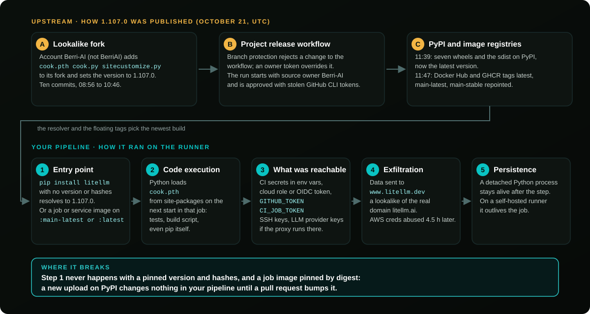

On October 21, 2026, `litellm` `1.107.0` went up on PyPI with three files that are not in the project's git tag. PyPI quarantined the release the same day.

`litellm` had 22.7 million PyPI downloads the week before, and many of them come from CI jobs that run `pip install litellm` with no version. If one of your pipelines did that on October 21, the pipeline was the door: the payload ran on the runner, next to that job's secrets.

## What happened

**The release**

- October 21, 11:39 to 11:40 UTC: seven `1.107.0` wheels and the sdist are uploaded to [PyPI](https://pypi.org/project/litellm/) and become the latest version.
- The wheels carry `cook.pth`, `cook.py` and `sitecustomize.py`. None of the three is in the `v1.107.0` git tag.
- The GitHub user who reported them, crediting the Upwind research team, describes a credential stealer that runs on every Python start ([issue #47826](https://github.com/BerriAI/litellm/issues/47826)).
- Within ten minutes, the Docker Hub and GitHub Container Registry tags `1.107.0`, `v1.107.0`, `latest`, `main-latest` and `main-stable` all point at the same poisoned build.

**The cleanup**

- PyPI quarantines the release before 13:10 UTC. The latest version goes back to `1.106.2`.
- The maintainers remove the images by 14:32 UTC.
- Per [Wiz](https://www.wiz.io/blog/litellm-compromised-steals-credentials), stolen AWS instance role credentials from CI runners and Kubernetes nodes are in use from 16:20 UTC, about 4.5 hours after the theft.

**How it was published**

The release came out of the project's own pipeline.

- Per [Socket](https://socket.dev/blog/litellm-compromise), the provenance of the poisoned image names the project's private release workflow, started with its source owner set to `Berri-AI` instead of `BerriAI`, and built from that lookalike fork.
- Per [StepSecurity](https://www.stepsecurity.io/blog/litellm-1-107-0-compromised-pypi-backdoored-wheels-credential-stealer), only `v1.107.0` was built from the fork. `v1.106.2`, `v1.106.1` and `v1.107.0-rc.2` record the real repository.
- Per the litellm team (16:32 UTC), the run was started from one engineer's GitHub account and approved from another's, both apparently through stolen GitHub CLI OAuth tokens.
- Per the team's [incident post](https://docs.litellm.ai/blog/security-incident-oct-21-2026), branch protection first rejected the attacker's change to the release workflow. A privileged credential overrode it five seconds later.
- In its 20:30 UTC update, the team said the tokens may have been exposed in the logs of an internal LiteLLM deployment reachable from the internet, and that a GitHub organization owner's token was used to disable branch protections. How the attacker got into that deployment is not confirmed.
- Customers of the private enterprise release were not affected.

## The Plumber take

Every week the same thing happens in a different registry. A trusted package ships a bad version, and the pipelines that install "whatever is newest" run it within minutes.

The fix is old and boring:

- pin versions,
- pin hashes,
- pin images by digest.

In our [State of CI/CD Security 2026](/blog/state-of-cicd-security-2026) research, 55% of projects still have unpinned or mutable dependencies.

**The runner is the crown jewel.** The PyPI wheel is just the delivery truck. What made `1.107.0` dangerous was where it landed: a CI job that holds the cloud role, the deploy key and the provider keys, for minutes on a hosted runner and much longer on a self-hosted one.

**Pipelines are production code**, on the publisher's side too. Three things on the maintainer's side did not hold:

- a release job that can be pointed at any repository is a publishing key for whoever types the name;
- a two-person rule does not help when the attacker holds both people's tokens;
- branch protection that a privileged account can override is a speed bump. Here it rejected the change, and an override let it through five seconds later.

**A tag is a name, not a promise.** `main-latest` and `main-stable` sound safe, and `main-stable` even sounds conservative. All five tags pointed at the same new build within a minute.

If your CI cannot say which bytes it ran on October 21, you cannot answer the question your CEO will ask today: "were we exposed?". That answer should take an hour, not a week.

## Are you exposed?

### The 60-second check

<Aside variant="caution" title="Three quick checks">

**1. Pinned to the bad version today** (repo files, GitHub or GitLab):

~~~bash
P='(^|[^a-z0-9_.-])litellm(\[[^]]*\])? *===? *1\.107\.0([^0-9a-z.]|$)|litellm-1\.107\.0([- ]|\.tar\.gz|\.dist-info|$)|7598727f209d717041db|0aaf7ba346d41ef2f403|668169d35b87bf513240|462d0c9f67ca522d9e0e|c2e32d0ce2548aa662c1|1bbce8caa94f01c0aaa0|12d4ccc5c6f8d35cf4f2|2befe2a79fb4fbbd9a54'
grep -rnE "$P" .
~~~

It covers requirements files, `uv.lock`, `poetry.lock` and `Pipfile.lock`.

**2. Installed during the window** (October 21 from 11:39 UTC): search the logs of every CI job that installed Python packages that day for the same pattern (commands below). This is the check that matters for unpinned installs.

**3. Your pipeline config**: `plumber analyze github.com/OWNER/REPO` or [your score](https://score.getplumber.io/github.com/OWNER/REPO). `ISSUE-103` lists every job or service image that is not pinned by digest, including `litellm/litellm:main-latest`.

</Aside>

### Detailed check

Two questions, in this order:

- **Exposed today**: do your files point at the bad version?
- **Exposed during the window**: did a job install it between October 21, 11:39 UTC and the removal? PyPI removed it by 13:23 UTC per the litellm team; the Docker Hub tags were cleaned at 14:20 UTC.

A hit in today's files does not prove exposure during the window. A clean repo today proves nothing about that day.

#### Your files, GitHub or GitLab

~~~bash
P='(^|[^a-z0-9_.-])litellm(\[[^]]*\])? *===? *1\.107\.0([^0-9a-z.]|$)|litellm-1\.107\.0([- ]|\.tar\.gz|\.dist-info|$)|7598727f209d717041db|0aaf7ba346d41ef2f403|668169d35b87bf513240|462d0c9f67ca522d9e0e|c2e32d0ce2548aa662c1|1bbce8caa94f01c0aaa0|12d4ccc5c6f8d35cf4f2|2befe2a79fb4fbbd9a54'
grep -rnE "$P" .
grep -rnE '^[^#]*pip3? install[^#]*litellm' .github/workflows .gitlab-ci.yml Dockerfile* 2>/dev/null
grep -rnE --include='*.txt' --include='*.in' --include='*.toml' '(^ *|")litellm(\[[^]]*\])? *($|[<>~!;#"])' .
~~~

- The first command finds the bad version, or its file hashes, in any lockfile format.
- The second lists every install line that names `litellm`.
- The third lists every requirement on `litellm` without `==`.

Any line without an exact version and hashes could have pulled `1.107.0` during the window.

#### GitHub Actions

List that day's runs and search their logs:

~~~bash
gh run list --created '>=2026-10-21' --limit 200 --json databaseId,workflowName,createdAt
gh run view <RUN_ID> --log | grep -E "$P"
~~~

- A hit in a log is a yes, even if your files are clean today.
- Delete the Actions caches built on October 21: `gh cache list`, then `gh cache delete <id>`. A dependency cache with an unchanged key can serve the bad version again.

#### GitLab CI

- Open the job logs of the pipelines that ran on October 21 and search for `litellm-1.107.0`. A hit is a yes, even if your files are clean today.
- Clear the runner caches built that day ("Clear runner caches" on the pipelines page).
- Purge `1.107.0` from any internal mirror or proxy (`Artifactory`, `Nexus`, `devpi`).

#### Machines, runners and images

Self-hosted runners, dev laptops, servers, containers. Do not run `pip` or `python` before this check: the payload runs on every Python start.

~~~bash
find / -name cook.pth -o -name cook.py -o -name litellm-1.107.0.dist-info 2>/dev/null
~~~

For containers, check every `litellm` image pulled on or after October 21, from Docker Hub or GitHub Container Registry, including the `litellm-database` and `litellm-non_root` variants:

~~~bash
D='sha256:(1bbcb1443bc9|c00f9d92c427|7b00e91cd2fe|bd1aeee419ea|56b74573eed6|24581ddc3076|827dd893c74c|645a67d81062|f75c8edae59b)'
docker image ls --digests | grep -E "$D"
kubectl get pods -A -o jsonpath='{range .items[*].status.containerStatuses[*]}{.imageID}{"\n"}{end}' | grep -E "$D"
~~~

A hit means you pulled the compromised `1.107.0` image. Socket verified the payload in it, and the maintainers have removed it.

- Treat every container started from it like a machine that ran `1.107.0`.
- Replace it with the `v1.106.2` image, pinned by digest.
- Check your Kubernetes manifests, Helm values and compose files: any `litellm` image on `latest`, `main-latest`, `main-stable` or `v1.107.0` restarted since then pulled it.

## The fix that would have stopped it

GitHub Actions, before:

~~~yaml
jobs:
  test:
    runs-on: ubuntu-latest
    services:
      proxy:
        image: litellm/litellm:main-latest
    steps:
      - uses: actions/checkout@v4
      - run: pip install litellm pytest
~~~

After:

~~~yaml
jobs:
  test:
    runs-on: ubuntu-latest
    permissions:
      contents: read
    services:
      proxy:
        image: litellm/litellm@sha256:7294b90f868c5c38c99b83021c7ba46f9b439e95f8e32964c925c7d2563a03f7  # v1.106.2
    steps:
      - uses: actions/checkout@v4
      - run: pip install --require-hashes -r requirements.txt  # litellm==1.106.2 with --hash lines
~~~

Generate the hashed file with `pip-compile --generate-hashes`, or use `uv sync --locked` with a committed `uv.lock`. Then a new upload on PyPI changes nothing in your pipeline until a pull request bumps it.

GitLab CI, same idea:

~~~yaml
test:
  image: python:3.12.7
  services:
    - name: litellm/litellm@sha256:7294b90f868c5c38c99b83021c7ba46f9b439e95f8e32964c925c7d2563a03f7
      alias: proxy
  script:
    - pip install --require-hashes -r requirements.txt
~~~

## Key takeaways

- `litellm` `1.107.0` on PyPI carried files that are not in its git tag. PyPI quarantined it on October 21. `1.106.2` is the version to use.
- Keep an exact pin: the litellm team cannot yet rule out further access to the accounts behind the release, and ordinary releases are paused.
- A pipeline that ran an unpinned `pip install litellm` on October 21 from 11:39 UTC should treat that job's secrets as stolen.
- Check your CI logs for that day, not only your repo. A clean lockfile today proves nothing about yesterday.
- If `1.107.0` ran where it could reach an AWS instance role, check CloudTrail now: per Wiz, stolen role credentials were used about 4.5 hours after the theft.
- The `latest`, `main-latest` and `main-stable` image tags on Docker Hub and GitHub Container Registry pointed at the compromised build until the maintainers removed it. Pin images by digest.
- If you publish packages, your release workflow should build only from your own repository. This one was started with a lookalike owner name.
- Do not run `pip` or `python` on a machine you suspect. Check for `cook.pth` from the shell first.

## Next steps

- Install the Plumber app to analyze and fix your pipelines: [github.com/apps/plumber-agent](https://github.com/apps/plumber-agent)
- Scan your pipelines with the open source CLI: [/docs/cli/github](/docs/cli/github)
- Star [getplumber/plumber](https://github.com/getplumber/plumber)
- Sources: [litellm issue #47826](https://github.com/BerriAI/litellm/issues/47826), [SafeDep analysis](https://safedep.io/litellm-pypi-compromise-credential-stealer-backdoor), [PyPI release page](https://pypi.org/project/litellm/1.107.0/), [Aikido intel](https://intel.aikido.dev/packages/pypi/litellm), [Socket](https://socket.dev/blog/litellm-compromise), [StepSecurity](https://www.stepsecurity.io/blog/litellm-1-107-0-compromised-pypi-backdoored-wheels-credential-stealer), [JFrog](https://research.jfrog.com/post/litellm-hijacked-again/), [Wiz](https://www.wiz.io/blog/litellm-compromised-steals-credentials), [litellm incident post](https://docs.litellm.ai/blog/security-incident-oct-21-2026)
