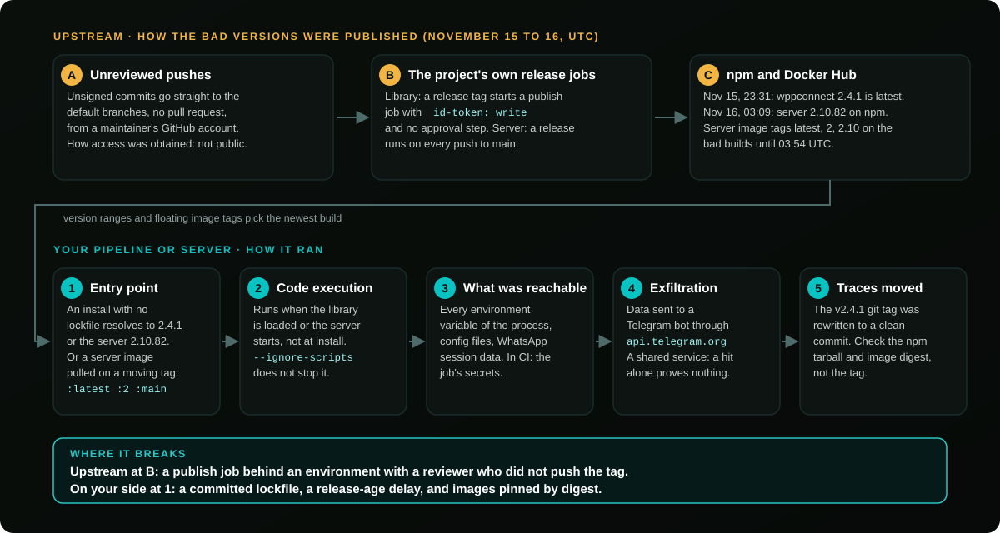

On November 15 and 16, 2026, malicious versions of the WPPConnect WhatsApp library and server went out on npm and Docker Hub: `@wppconnect-team/wppconnect` `2.4.1` and `@wppconnect/server` `2.10.82`. They send environment variables, config files and WhatsApp session data to a Telegram bot.

The library had 7,498 npm downloads the week before. No npm token was needed. Unreviewed commits went through the project's own release workflows, and npm trusted publishing signed them off. The pipeline was the door, on the publisher's side this time.

## What happened

**The releases**

- November 15, 23:31 UTC: `@wppconnect-team/wppconnect` `2.4.1` lands on [npm](https://www.npmjs.com/package/@wppconnect-team/wppconnect) and becomes `latest`.
- November 16, 03:09 UTC: `@wppconnect/server` `2.10.82` lands on [npm](https://www.npmjs.com/package/@wppconnect/server). The server depends on the library at `^2.3.6`, so a fresh install of the server also pulled `2.4.1`.
- The same pipelines built `2.4.3` and `2.10.83`, which are not listed on npm, per [StepSecurity](https://www.stepsecurity.io/blog/wppconnect-compromised-malicious-releases-steal-secrets-and-whatsapp-sessions).
- On [Docker Hub](https://hub.docker.com/r/wppconnect/wppconnect-server/tags), `wppconnect/wppconnect-server` `2.10.82` and `2.10.83` were pushed from 02:48 UTC. Per StepSecurity, `latest`, `2` and `2.10` pointed at the bad builds until 03:54 UTC. It could not tell whether `main`, last updated at 07:31 UTC, held a bad image before then. The GitHub `nightly` release asset was affected until 03:53 UTC.
- Per StepSecurity, the code runs when the library is loaded or the server starts, not at install. `--ignore-scripts` does not stop it.

**How it was published**

- Per StepSecurity, unsigned commits were pushed straight to the default branches, with no pull request, through one maintainer's GitHub account. How access was obtained is not public.
- Library: a release run creates a tag, and the tag starts `publish.yml`. That job has `id-token: write` and no `environment:`, so nobody had to approve the publish ([workflow at the release commit](https://github.com/wppconnect-team/wppconnect/blob/dee571e55aef07e648d675055a45fcef13f9e586/.github/workflows/publish.yml)).
- Server: `release.yml` runs on every push to `main`. The malicious push released `2.10.82` by itself ([workflow at the release commit](https://github.com/wppconnect-team/wppconnect-server/blob/ccdc9c9eb6fed6cf17067fbedbc0b0c62aacb7ea/.github/workflows/release.yml)).
- Both npm versions show "GitHub Actions" as publisher, through trusted publishing. The library version also carries valid build provenance, which names the malicious commit.
- Per StepSecurity, the `v2.4.1` git tag was later rewritten to a commit without the payload. Do not use git tags to check what you installed.

**The cleanup**

- November 16, 04:00 UTC: a user reports both versions ([wppconnect #2968](https://github.com/wppconnect-team/wppconnect/issues/2968), [wppconnect-server #2734](https://github.com/wppconnect-team/wppconnect-server/issues/2734)).
- Both versions were first deprecated on npm, with notices to pin `2.4.0` and `2.10.81` "pending a reviewed release". As of November 25 they are removed from npm and no longer install.
- At 14:44 UTC a maintainer wrote that containment of the publishing access is not confirmed yet. On November 22 the same maintainer wrote on [#2968](https://github.com/wppconnect-team/wppconnect/issues/2968) that the identity and credential used for the pushes are still unverified, and kept the issue open.
- November 18, 13:37 UTC: `@wppconnect-team/wppconnect` `2.4.6` was published from a maintainer account, without build provenance, and is now `latest`.
- November 24: `@wppconnect/server` `2.10.93` to `2.10.97` were published by the project's workflow. Since `2.10.95`, each npm release waits for a maintainer's approval ([#2756](https://github.com/wppconnect-team/wppconnect-server/pull/2756)). `2.10.97`, now `latest`, carries build provenance and needs the library at `^2.4.6`.
- November 17, 06:31 UTC: GitHub published malware advisories for both packages, [GHSA-rj96-rg6c-9hw8](https://github.com/advisories/GHSA-rj96-rg6c-9hw8) (`= 2.4.1`) and [GHSA-96hm-h5v4-92fq](https://github.com/advisories/GHSA-96hm-h5v4-92fq) (`= 2.10.82`), credited to OpenSSF.

## The Plumber take

**Trusted publishing proves where a release came from, not that anyone read it.** WPPConnect did the modern thing: no long-lived npm token, OIDC from GitHub Actions, provenance on the library. Every one of those checks passed. The provenance even points at the bad commit. It is a receipt, not a review.

**Pipelines are production code**, and here the release jobs had no human step at all:

- a release that runs on every push to `main` turns any push into a publish;
- a publish job that can request an npm token, with no environment and no required reviewer, ships whatever the tag points at;
- a default branch that takes direct pushes, without a pull request, makes the first two a one-step attack.

In our [State of CI/CD Security 2026](/blog/state-of-cicd-security-2026) research, 49% of projects leave their default branch unprotected. That branch is where your releases start.

**A tag is a name, not a promise.** The `v2.4.1` git tag was rewritten after the fact, and the `latest`, `2` and `2.10` image tags moved twice in one night. Check the tarball hash and the image digest.

On your side, the question is the same as with every bad release: "were we exposed?". If your CI installs the newest version on every run and keeps no record of what it pulled, that answer takes a week. It should take an hour.

## Are you exposed?

### The 60-second check

<Aside variant="caution" title="Three quick checks">

**1. Pinned to a bad version today** (repo files, GitHub or GitLab):

~~~bash
P='@wppconnect-team/wppconnect(@|@npm:|/|/-/wppconnect-)2\.4\.1([^0-9]|$)|"@wppconnect-team/wppconnect": *"2\.4\.1"|@wppconnect/server(@|@npm:|/|/-/server-)2\.10\.82([^0-9]|$)|"@wppconnect/server": *"2\.10\.82"|wppconnect-server:v?2\.10\.8[23]([^0-9]|$)|b7ifN9DEUR//0ImJojfw|zDf9tuP7v92dvkBxwLQJ|755274304012c7489e85|68925177e1fb4f05e195|56a546a38f6e59509f62|cc01ce839afeaf865cfe'
grep -rnE "$P" .
~~~

It covers `package.json`, `package-lock.json`, `yarn.lock` (v1 and Berry), `pnpm-lock.yaml`, `bun.lock` and compose files.

**2. Installed or pulled during the window** (November 15 from 23:31 UTC to November 16 07:31 UTC, the last change to the `main` image tag): list the CI jobs that installed npm packages without a lockfile, or pulled `wppconnect/wppconnect-server`, in that window (commands below).

**3. Your pipeline config**: `plumber analyze github.com/OWNER/REPO` or [your score](https://score.getplumber.io/github.com/OWNER/REPO). `ISSUE-103` lists every job container image and `docker://` step that is not pinned by digest, including `wppconnect/wppconnect-server:latest`. If you publish packages, check by hand that every job with `id-token: write` has an `environment:` with required reviewers.

</Aside>

### Detailed check

Two questions, in this order:

- **Exposed today**: do your files point at a bad version or a bad image digest?
- **Exposed during the window**: did a job, server or container load `2.4.1` or start `2.10.82` or `2.10.83`?

A hit in today's files does not prove the code ran. A clean repo today proves nothing about that night.

Per [GitHub's advisory](https://github.com/advisories/GHSA-96hm-h5v4-92fq), the code skips machines that look like CI environments or sandboxes, so servers, bot hosts and laptops are where it most likely ran. Check your CI jobs anyway: if one loaded a bad version, treat its secrets as exposed.

#### Your files, GitHub or GitLab

~~~bash
grep -rnE "$P" .
grep -rnE '^[^#]*(npm|yarn|pnpm|bun)( install| i | add)[^#]*wppconnect' .github/workflows .gitlab-ci.yml Dockerfile* 2>/dev/null
grep -rnE '"@wppconnect(-team/wppconnect|/server)": *"[~^]' --include=package.json .
~~~

- The first command finds a bad version, its tarball hashes or a bad image digest, in any lockfile format.
- The second lists every install line that names a WPPConnect package.
- The third lists every `package.json` range that could move to a new version on a fresh install.

No lockfile, or a CI job that runs `npm install` instead of `npm ci`, means a range could have pulled `2.4.1` during the window. Pin `2.4.0` and `2.10.81`. If you use the server, add an `overrides` entry pinning the library to `2.4.0`, as StepSecurity advises. Server `2.10.93` and later need the library at `^2.4.6`, so that pin goes with server `2.10.81`.

#### GitHub Actions

List the runs in the window and check what they installed:

~~~bash
gh run list --created '2026-11-15T23:00:00Z..2026-11-16T08:00:00Z' --limit 200 --json databaseId,workflowName,createdAt
gh run view <RUN_ID> --log | grep -E "$P"
~~~

- npm does not print every version it installs, so no hit in a log is not a no. Check the lockfile at the commit each run used.
- Delete the Actions caches built in the window: `gh cache list`, then `gh cache delete <id>`. A cached `node_modules` or npm cache can serve the bad version again.

#### GitLab CI

- Open the job logs of the pipelines that ran in the window and search for `wppconnect`. Check the lockfile of the commit each job used.
- Clear the runner caches built in the window ("Clear runner caches" on the pipelines page).
- Purge `2.4.1` and `2.10.82` from any internal mirror or proxy (`Artifactory`, `Nexus`, `Verdaccio`).

#### Machines, runners and images

Servers, bot hosts, self-hosted runners, dev laptops. The library writes a marker file in the temp directory, and the bad builds carry a `diagnostics.js` file:

~~~bash
find / -name .wpp-support-diag -o -name .wpp-diag -o -path '*/node_modules/@wppconnect*/dist/util*/diagnostics.js' 2>/dev/null
~~~

For containers, check every `wppconnect/wppconnect-server` image pulled on November 16:

~~~bash
D='sha256:(56a546a38f6e|cc01ce839afe)'
docker image ls --digests | grep -E "$D"
kubectl get pods -A -o jsonpath='{range .items[*].status.containerStatuses[*]}{.imageID}{"\n"}{end}' | grep -E "$D"
~~~

Also search your DNS, proxy and egress logs for `api.telegram.org` from hosts that run WPPConnect. Per StepSecurity, Telegram and `api.ipify.org` are shared services: a hit alone does not prove infection.

If any check hits, follow [StepSecurity's remediation](https://www.stepsecurity.io/blog/wppconnect-compromised-malicious-releases-steal-secrets-and-whatsapp-sessions):

- treat every secret the process or CI job could read as stolen, and rotate it from a clean machine;
- sign out and unlink the WhatsApp sessions, delete the old session token files, and re-pair only after pinning a clean version;
- replace the image with `2.10.81`, pinned by digest, and check your compose files, Kubernetes manifests and Helm values for `latest`, `2`, `2.10` or `main`.

## The fix that would have stopped it

On the consumer side, GitHub Actions, before:

~~~yaml
jobs:
  test:
    runs-on: ubuntu-latest
    services:
      wpp:
        image: wppconnect/wppconnect-server:latest
    steps:
      - uses: actions/checkout@v4
      - run: npm install
~~~

After:

~~~yaml
jobs:
  test:
    runs-on: ubuntu-latest
    permissions:
      contents: read
    services:
      wpp:
        image: wppconnect/wppconnect-server@sha256:<digest of 2.10.81>
    steps:
      - uses: actions/checkout@v4
      - run: npm ci  # committed package-lock.json with wppconnect 2.4.0
~~~

`npm ci` installs exactly what the lockfile says, so a new upload on npm changes nothing until a pull request bumps it. Per StepSecurity, a 24-hour release-age delay would also have kept `2.4.1` out: pnpm has `minimumReleaseAge`, Yarn has `npmMinimalAgeGate`.

On the publisher side, the job that publishes, before:

~~~yaml
on:
  push:
    tags: ['v*']
permissions:
  id-token: write
  contents: write
jobs:
  publish:
    runs-on: ubuntu-latest
~~~

After:

~~~yaml
on:
  push:
    tags: ['v*']
permissions:
  contents: read
jobs:
  publish:
    runs-on: ubuntu-latest
    environment: npm-release  # required reviewers who did not push the tag
    permissions:
      contents: read
      id-token: write
~~~

Then set the same environment name in the package's trusted publisher settings on npm, so a run outside that environment cannot publish. Protect the default branch (pull request required, force pushes blocked) and put a ruleset on your release tags.

GitLab CI, same idea:

~~~yaml
test:
  image: node:22.12.0
  services:
    - name: wppconnect/wppconnect-server@sha256:<digest of 2.10.81>
      alias: wpp
  script:
    - npm ci

publish:
  rules:
    - if: $CI_COMMIT_TAG =~ /^v/
  environment: npm-release  # protected environment with required approval
  id_tokens:
    NPM_ID_TOKEN:
      aud: "npm:registry.npmjs.org"
  script:
    - npm ci
    - npm publish
~~~

## Key takeaways

- `@wppconnect-team/wppconnect` `2.4.1` and `@wppconnect/server` `2.10.82` are malicious. Pin `2.4.0` and `2.10.81`, with a committed lockfile.
- If you run the server, pin the library to `2.4.0` with an `overrides` entry: the server's `^2.3.6` range reaches `2.4.1`.
- Server images pulled on November 16 on `latest`, `2`, `2.10` or `main` may be the bad build. Compare digests, not tags, and pin by digest.
- If a bad version loaded, treat every secret the process could read as stolen, and re-pair WhatsApp sessions only after pinning a clean version.
- `2.4.6`, now `latest`, came out before the maintainers confirmed containment, without build provenance. A fresh install on a `^2.4.0` range pulls it, and so does server `2.10.93` or later. Stay on `2.4.0` and server `2.10.81` until the maintainers confirm containment.
- Trusted publishing and provenance tell you which pipeline built a release. They do not tell you anyone reviewed it.
- If you publish packages, put the publish job behind an environment with required reviewers, and never release on every push to `main`.

## Next steps

- Install the Plumber app to analyze and fix your pipelines: [github.com/apps/plumber-agent](https://github.com/apps/plumber-agent)
- Scan your pipelines with the open source CLI: [/docs/cli/github](/docs/cli/github)
- Star [getplumber/plumber](https://github.com/getplumber/plumber)
- Sources: [StepSecurity](https://www.stepsecurity.io/blog/wppconnect-compromised-malicious-releases-steal-secrets-and-whatsapp-sessions), [GHSA-rj96-rg6c-9hw8](https://github.com/advisories/GHSA-rj96-rg6c-9hw8), [GHSA-96hm-h5v4-92fq](https://github.com/advisories/GHSA-96hm-h5v4-92fq), [npm: @wppconnect-team/wppconnect](https://www.npmjs.com/package/@wppconnect-team/wppconnect), [npm: @wppconnect/server](https://www.npmjs.com/package/@wppconnect/server), [wppconnect issue #2968](https://github.com/wppconnect-team/wppconnect/issues/2968), [wppconnect-server issue #2734](https://github.com/wppconnect-team/wppconnect-server/issues/2734), [Docker Hub tags](https://hub.docker.com/r/wppconnect/wppconnect-server/tags), [library publish.yml](https://github.com/wppconnect-team/wppconnect/blob/dee571e55aef07e648d675055a45fcef13f9e586/.github/workflows/publish.yml), [server release.yml](https://github.com/wppconnect-team/wppconnect-server/blob/ccdc9c9eb6fed6cf17067fbedbc0b0c62aacb7ea/.github/workflows/release.yml)
